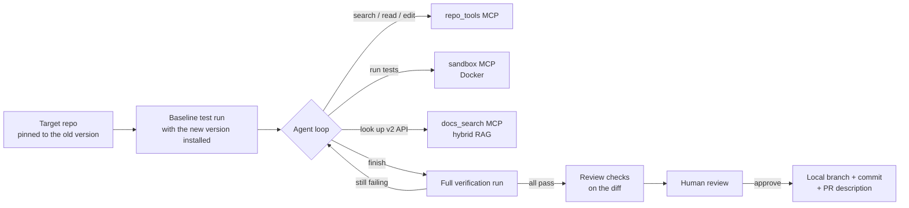

# Migration Agent

An autonomous AI agent that upgrades Python codebases across breaking library releases. Given a
repository written for an old major version (**Pydantic v1** or **SQLAlchemy 1.4**), it upgrades
the dependency, runs the project's own test suite, reads the migration guide, fixes what broke, and
verifies the result with the full suite. A human then reviews the diff and approves a branch.

**Result:** on a benchmark of 18 real open-source projects across two libraries, Claude Haiku 5.5
completed **52 of 53 migrations** (3 attempts per project): 37/38 for Pydantic v1 → v2 and 15/15
for SQLAlchemy 1.4 → 2.0, at about **$0.025 per run**. No run edited or skipped a test. Passing tests
isn't the whole story, so completeness was measured too: in **92%** of measurable successful runs no
deprecated old-version API is left; most exceptions are one project, where the agent migrated the
library but left v1 config in its example modules (see "What the success rate does and doesn't measure").

| | |
|---|---|
| Agent loop | hand-written Python, plus an equivalent LangGraph version for comparison |
| Tools | [MCP](https://modelcontextprotocol.io) servers: repo tools, Docker test sandbox, docs search, git |
| Models | Claude (default), Gemini, Groq behind one small interface |
| Verification | the project's own tests in Docker, plus automatic review checks on the final diff |
| Observability | every model and tool call recorded; React dashboard with per-run charts |

---

## How it works



1. **Baseline.** The repo is installed in a fresh Docker container, the library is upgraded to
   the new version, and the tests run. The failures, grouped by root cause, become the agent's first message.
2. **Loop.** Each step: send the conversation to the model, run the tool it picks, append the
   result. The agent can only act through tools:
   - `repo_tools`: list, search, read and edit files. Edits are exact-text replacements, and a
     failed edit returns the closest matching lines so the model can copy them.
   - `sandbox`: install and run the tests in Docker, and return a **structured summary**: failures
     grouped by root cause, with the error type, message and the deepest `file:line` *inside the repo*.
   - `docs_search`: search the official migration guides of the library being upgraded (Pydantic's
     is Markdown, SQLAlchemy's is reStructuredText; both are chunked by heading).

   Library-specific rules (what counts as a shortcut, which imports are compatibility shims) live
   in one small profile per library (`agent/libraries.py`); the loop itself is library-agnostic.
3. **Finish is a request, not a declaration.** When the model calls `finish`, the loop runs the
   full suite itself and only stops if it passes; otherwise the model gets the failures back.
4. **Review checks** run on the final diff and flag what tests can't catch: pins that still allow
   the old version, removed dependencies, compatibility shims, test edits.
5. **Human review.** `python -m agent.review runs/<id>` shows the outcome, the agent's summary, the
   findings and the diff, then asks for approval. On approval it creates a local branch with one
   commit and writes a PR description built only from recorded data.

### Guardrails, and why they're in code rather than the prompt

- **Tests can't be edited or skipped.** The edit tool refuses test files and refuses to add
  `skip`/`xfail` markers; `run_tests` refuses pytest flags such as `-k` or `--deselect`.
- **Only files inside the target repo** can be read or edited.
- **Step and token budgets** stop a run; the budget counts *billable* tokens, since cached input
  costs about 1/20 of normal input.
- **The model never gets git tools.** If it could commit or open a PR, "a human approves first"
  would only be a request in the prompt. Only the review command, run by a person, creates a branch.

---

## Results

### Pydantic v1 → v2: 13 real projects, Claude Haiku 5.5, docs search on, 3 runs each

Each task is a public repo pinned to a commit that depends on Pydantic v1. A task is only
accepted after a sandbox check: its own tests pass on v1 and genuinely fail on v2.

| Project | Difficulty | What breaks under v2 | Succeeded | Median steps | Avg cost | Tests after |
|---|---|---|---|---|---|---|
| [geojson-pydantic](https://github.com/developmentseed/geojson-pydantic) | easy | removed `ErrorWrapper`, `GenericModel` | 3/3 | 15 | $0.016 | 134/134 |
| [pyonwater](https://github.com/kdeyev/pyonwater) | easy | `Optional` fields become required (behaviour change) | 3/3 | 13 | $0.008 | 25/25 |
| [FastApi-RESTful](https://github.com/yuval9313/FastApi-RESTful) | medium | `is_classvar`, `BaseSettings` moved, `orm_mode` | 3/3 | 13 | $0.010 | 69/69 |
| [pydantic-sqlite](https://github.com/Phil997/pydantic-sqlite) | medium | `ModelField` and field introspection | 3/3 | 17 | $0.021 | 30/30 |
| [dbt-cloud-cli](https://github.com/data-mie/dbt-cloud-cli) | medium | v1 validator signatures, field internals | 3/3 | 29 | $0.041 | 31/31 |
| [pydantic-cli](https://github.com/mpkocher/pydantic-cli) | hard | core built on v1 field internals | 3/3 | 32 | $0.052 | 35/35 |
| [gto](https://github.com/iterative/gto) | hard | `BaseSettings` with custom sources, `parse_obj_as` | 3/3 | 28 | $0.038 | 141/141 |
| [copier](https://github.com/copier-org/copier) | hard | v1 error/validator internals, pydantic dataclasses | 1/2 | 39.5 | $0.085 | 691/696* |
| [ConfZ](https://github.com/Zuehlke/ConfZ) | easy | inner `Config` (`allow_mutation`) | 3/3 | 20 | $0.015 | 42/42 |
| [withings-api](https://github.com/vangorra/python_withings_api) | medium | v1 custom types (`__get_validators__`), validators | 3/3 | 19 | $0.019 | 32/32 |
| [morecantile](https://github.com/developmentseed/morecantile) | medium | `conlist(min_items=)`, custom root `__root__` | 3/3 | 23 | $0.031 | 183/186* |
| [basin3d](https://github.com/BASIN-3D/basin3d) | medium | custom type schema, `class Config` | 3/3 | 22 | $0.030 | 484/486* |
| [Netlist](https://github.com/dan-fritchman/Netlist) | hard | `GenericModel`, `__pydantic_model__`, pydantic dataclasses | 3/3 | 11 | $0.009 | 20/20 |

\* Skipped tests are skipped on v1 too. copier's third run was cut short twice by infrastructure and isn't counted.
The failed run reached 690/696 before the 40-step limit. The successful run solved the hardest part
without touching tests: upstream's own port *changed* a test that expects a `TypeError`, while the
agent kept v1 behaviour by making `Worker` a plain dataclass and validating its fields with a separate
Pydantic model in `__post_init__`.

### SQLAlchemy 1.4 → 2.0: 5 real projects, same setup

The upgrade is capped at `<2.1`: uncapped, pip installed 2.1.9, which would mix 2.1's own changes
into a 2.0 migration.

| Project | Difficulty | What breaks under 2.0 | Succeeded | Median steps | Avg cost | Tests after |
|---|---|---|---|---|---|---|
| [agate-sql](https://github.com/wireservice/agate-sql) | easy | `MetaData(connection)`, `autoload=True`, `select([...])` | 3/3 | 13 | $0.010 | 18/18 |
| [coilmq](https://github.com/coilmq/coilmq) | easy | bound `MetaData`, `select([...])`, `row[Column]` | 3/3 | 11 | $0.015 | 201/204* |
| [dataset](https://github.com/pudo/dataset) | medium | bound `MetaData`, `engine.execute`, library-level autocommit removed | 3/3 | 19 | $0.027 | 57/57† |
| [rdflib-sqlalchemy](https://github.com/RDFLib/rdflib-sqlalchemy) | medium | `select([...])`, positional `select()`/`delete()` arguments | 3/3 | 22 | $0.032 | 44/48* |
| [sqladmin](https://github.com/aminalaee/sqladmin) | easy | string attribute names in loader options removed | 3/3 | 12 | $0.007 | 140/142* |

\* Skipped tests are skipped on 1.4 too (other databases). † Two tests call `Table.exists()`, removed
in 2.0, from the test code itself; they can't pass without editing tests, so the task deselects them.

The interesting one is **dataset**: SQLAlchemy 2.0 no longer commits writes executed directly on a
connection, but dataset's own API promises that they are saved. All three runs kept that promise
with explicit `conn.commit()` calls on the 2.0 API, rather than reviving the old behaviour. One
rdflib-sqlalchemy run left `SQLAlchemy>=1.4,<3.0` in `setup.py`; the pin check flags it, because
the migrated code no longer works on 1.4.

### What the success rate does and doesn't measure

"Succeeded" means the project's own full test suite passes on the new version, with no test
edited or skipped (enforced by the tools, then checked on the diff). That is necessary for a
correct migration but not sufficient, so three more things were measured or stated:

**Migration completeness.** Pydantic v2 still *runs* most v1-style code (`.dict()`, `@validator`,
`class Config`) and only warns, so tests can pass on a half-done migration. `benchmark/completeness.py`
replays every successful run's diff on the pinned commit, runs the exact graded test command, and
counts the deprecated old-API call sites in the project's own source that the suite still hits.

| | Successful runs | Measurable | No deprecated API left |
|---|---|---|---|
| Hand-written loop | 52 | 49 | 45 |
| LangGraph | 53 | 50 | 46 |
| **Total** | **105** | **99** | **91 (92%)** |

All 105 replays reproduced the original result. The 6 that aren't measurable are rdflib-sqlalchemy,
whose pytest config hides every `DeprecationWarning`. Of the 8 incomplete ones:

- **6 are every pydantic-cli run, in both agents:** the core was migrated, but v1 `class Config`
  blocks were left in the package's `examples/` modules (10–29 call sites), which the tests import
  and v2 still accepts with a warning. A migration a user would copy from those examples is still v1.
  Systematic, so it's a model behaviour on that code base, not a loop bug.
- **2 are single leftovers:** one `parse_file` call in a morecantile run and one `.copy()` (now
  `model_copy`) in a basin3d run. The other runs of both tasks are clean.

The metric only sees code the tests execute; it was checked against a positive control
(geojson-pydantic's unmigrated code is flagged).

**Task selection.** Tasks are chosen so their *tests* only use APIs that survive the upgrade,
because the agent may not edit tests. That's a deliberate rule, but it means projects whose own test
suites are tied to the old version aren't represented. Several candidates were rejected for exactly
that (listed with reasons in `benchmark/tasks.yaml`).

**No held-out tests.** The agent is graded by the same suite it can run. Completeness and the
review checks are the independent signals; grading against upstream's own post-migration tests
(where upstream ported) is the next step.

Full traces for every run in these tables are in `benchmark/traces/` (scrubbed of local paths and
emails); unpack into `runs/` to inspect them in the dashboard.

### Model comparison (same tasks, earlier runs)

| Model | geojson-pydantic | FastApi-RESTful | pydantic-cli |
|---|---|---|---|
| Claude Opus 5.5 | 11 steps, $0.28 | 8 steps, $0.15 | 34 steps, $1.14 |
| Claude Haiku 5.5 | 15 steps, $0.016 | 13 steps, $0.010 | 32 steps, $0.052 |

On these tasks Haiku succeeds about as reliably as Opus at **20–50× lower cost**.

### Hand-written loop vs LangGraph (Haiku, all 18 tasks, 3 runs each)

The same agent was rebuilt as a LangGraph `StateGraph` (`agent_langgraph/`): nodes for baseline,
model call, tools, nudge and final run, with routing functions between them. It deliberately reuses
the same LLM client, MCP tools, prompts, budgets and trace format, so only the orchestration differs;
a test runs one scripted session through both and asserts identical event streams.

| | Hand-written loop | LangGraph |
|---|---|---|
| Succeeded | 52/53 | 53/54 |
| Median steps | 19 | 19 |
| Mean cost per run | $0.025 | $0.024 |
| Review-check findings | 1 warning (a weak pin) | none |
| No deprecated API left (completeness) | 45/49 | 46/50 |
| Code for the control flow | 75 lines | 143 lines |
| New dependencies | none | `langgraph` (+ ~20 packages) |

Per task, the two are within run-to-run noise of each other (copier, the only task either one
failed, went 1/2 vs 2/3). That is the expected result: with the model, tools and prompts held
constant, the framework doesn't change *what* the agent does. What it changes is the code. The graph
makes the control flow explicit and testable (each routing decision is a small named function), makes
the append-only history structural (nodes can only *add* messages via a reducer), and comes with
hooks for checkpointing and human-in-the-loop interrupts. It costs twice the code for this loop, a
dependency tree, and a recursion limit that has to be set above the agent's own budgets. For a
single-agent loop this size, the hand-written version is simpler; LangGraph would pay off with
branching workflows, resumable runs or several cooperating agents.

For the first 12 tasks, the loop's runs are from 17–18 Nov and LangGraph's from 18–22 Nov; the
only code change in between that reaches the model is the per-library wording of one prompt rule.
The 6 newer tasks were run with both agents on 22–23 Nov.

### Does docs search help? (Haiku, 3 runs per setting)

| Project | Success (off → on) | Median steps (off → on) |
|---|---|---|
| geojson-pydantic | 3/3 → 3/3 | 19 → 15 |
| FastApi-RESTful | 3/3 → 3/3 | 16 → 11 |
| pydantic-cli | 3/3 → 3/3 | 27 → 29 |

Docs search doesn't change *whether* Haiku succeeds on these tasks. It tends to shorten the easier
ones and shows no benefit on the hard one. With 3 runs per setting this is a tendency, not proof.

### Retrieval: why the RAG is mostly keyword search

The docs index was evaluated on queries phrased the way the agent actually searches: mostly exact
identifiers and error messages (`orm_mode`, `ModelField`; `'Engine' object has no attribute
'execute'`, `select([users.c.id])`). Each library's queries are scored against its own guides only,
the same filter the agent gets. Right section in the top 3:

| Strategy | Pydantic (of 16) | SQLAlchemy (of 15) |
|---|---|---|
| Semantic only (embeddings, the "classic RAG") | 8 | 13 |
| Keyword only (BM25) | 15 | 13 |
| Hybrid, equal weights | 15 | 14 |
| **Hybrid, keyword ×2 (shipped)** | **16** | **15** |

The two guides favour different methods: Pydantic searches are dominated by identifiers, while
SQLAlchemy's guide is mostly prose, so embeddings do far better there. Only the hybrid finds the
right section for every query in both.

---

## Lessons from building it

Most of the effort went into making the environment trustworthy, and most of the agent's odd
behaviour turned out to be caused by the harness, not the model.

- **A harness conflict produced a "passing but wrong" migration.** An era pin in the install
  command made the agent's correct dependency bump fail to install, so the agent hand-rolled
  `BaseSettings` to get the tests green, and said so in its summary. After separating the repo's
  own dependencies from the harness's test dependencies, the same model did the proper
  `pydantic-settings` migration in 8 steps instead of 28.
- **Passing tests aren't enough.** That run led to the review checks. A prompt rule about companion
  packages then took "pin still allows an incompatible version" from 2/6 runs to 0/18.
- **Line endings mattered.** With Windows' `core.autocrlf=true` every checked-out repo had CRLF
  endings, so scripts run by tests failed in the Linux sandbox (`python\r`). Checkouts are now
  byte-identical to upstream.
- **Failure reports must survive odd crashes.** When pytest dies before writing JUnit XML (an
  import error in `conftest.py`), the summary falls back to parsing the traceback; one broken test
  module no longer hides the rest (`--continue-on-collection-errors`).
- **Benchmark tasks need real verification.** None of the six candidates found by static code
  review passed its v1 baseline on the first try: test plugins, CLI libraries and git bindings had
  all moved on. Every task is pinned and verified in the sandbox before it's accepted.
- **Silent checks are the dangerous ones.** The first SQLAlchemy pass scored dataset 0/3: every run
  stopped at exactly 57/59. A `--deselect` for two impossible tests named the wrong test class, and
  pytest silently ignores a deselect that matches nothing. The verification had shown it ("59
  passed" where 57 were expected) and I missed it. A test now checks that every deselected test
  exists; with the fix, dataset went 3/3. The same pass showed the pin check never read `setup.py`
  (Pydantic's repos happened not to need it), so a weak pin went unflagged.
- **Laptops sleep in the middle of experiments.** Sleep pauses Docker and drops the network, so a
  test run outlives the MCP timeout or the model's HTTP stream breaks; several LangGraph runs were
  lost this way (recorded as infrastructure failures and rerun, never counted as agent failures). Blocking
  idle sleep wasn't enough: on a Modern Standby laptop the screen turning off *is* the sleep trigger,
  so the runner now asks Windows to keep the display on for the length of an experiment.
- **Cost is a caching problem.** Each step resends the whole conversation; keeping the history
  append-only lets Claude's prompt cache serve 75–95% of input at a fraction of the price.

---

## Running it

Requirements: Python 3.11+, [uv](https://docs.astral.sh/uv/), Docker, and an API key for Claude,
Gemini or Groq.

```bash
uv sync
cp .env.example .env                      # add ANTHROPIC_API_KEY (or another provider's key)
docker build -t migration-agent-sandbox:py3.11 sandbox
uv run python -m mcp_servers.docs_search.build    # one-time: download and index the migration guides

# Run the agent on one benchmark task (clones it into workspace/)
uv run --env-file .env python -m agent.loop --task geojson-pydantic

# Review the result: approve -> local branch + PR description
uv run python -m agent.review runs/<run-id>

# Run an experiment: tasks x models x docs on/off, N repeats -> benchmark/results/*.json
uv run --env-file .env python -m benchmark.runner --name my-exp --models claude-haiku-5-5 --docs both --repeats 3

# Dashboard (http://localhost:8000)
cd dashboard/web && npm install && npm run build && cd ../..
uv run uvicorn dashboard.api:app --port 8000
```

Tests: `uv run pytest` (about 150 tests; the Docker end-to-end test is opt-in with `-m docker`).

## Project layout

```
agent/            loop.py (the agent loop), llm.py (Claude/Gemini/Groq), prompts.py, libraries.py,
                  trace.py (run recording), checks.py (review checks), review.py (human review)
agent_langgraph/  graph.py (the same agent as a LangGraph StateGraph), run.py (its CLI)
mcp_servers/      repo_tools/, sandbox/, docs_search/, git_tools/
sandbox/          Dockerfile + entrypoint for running a target repo's tests
benchmark/        tasks.yaml (verified tasks), runner.py (experiments), results/ (committed results)
dashboard/        FastAPI backend + React frontend over runs/
docs/             WRITEUP.md (design decisions and lessons), DEMO_SCRIPT.md
tests/            tests for this project's own code
```

## Limitations and next steps

- **Small benchmark.** 18 verified projects, so every number has wide error bars. Small SQLAlchemy libraries that pinned `<2` *and* have SQLite-only tests that
  survive the upgrade turned out to be rare; most candidates were rejected.
- **The SQLAlchemy tasks are Core-heavy and SQLite-only.** None of them exercises the 2.0-style ORM
  (`Mapped[]`, `DeclarativeBase`) or a server database; those would be harder tasks.
- **No memory module yet.** Across ~60 runs no agent repeated a failed fix, so it was deferred
  until a task needs it.
- **The LangGraph version doesn't use LangGraph's extras yet** (checkpointing to resume a run after
  a crash, an interrupt node for human review); those are where it would start to earn its cost.
